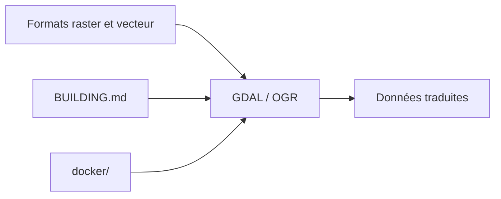

# OSGeo/gdal

> Bibliothèque de traduction de formats de données géospatiales raster et vecteur, pour les géomaticiens.

## Le problème
Les données géospatiales existent en des dizaines de formats : les lire et les convertir demande une couche commune.

## Ce que ça fait vraiment
GDAL lit et écrit des données raster et vectorielles dans de nombreux formats. Le README est court et renvoie au site gdal.org pour la documentation. Il pointe aussi vers BUILDING.md, des images Docker et la politique de sécurité.

## Comment c'est branché

Schéma simplifié d'après la fiche, sans diagramme fourni.

## Essayer
```bash
# Aucune commande dans le README :
# voir BUILDING.md, le dossier docker/ et https://gdal.org
```

## Coût et pièges
Gratuit. Compilation lourde ou images Docker, à voir dans BUILDING.md. Le README se dit sous licence MIT, mais GitHub ne l'identifie pas : à vérifier. 608 issues ouvertes.

## Ce que ce n'est pas
Ce n'est pas un SIG avec interface : c'est une bibliothèque, pas un logiciel de cartographie. Le README ne détaille pas ses fonctions.

## Alternatives
Le README n'en nomme aucune.

## Pour toi
À adopter si tu manipules des données géospatiales (rasters, imagerie satellite) : c'est la brique de référence sous bien des outils, avec un projet financé par NumFOCUS.

