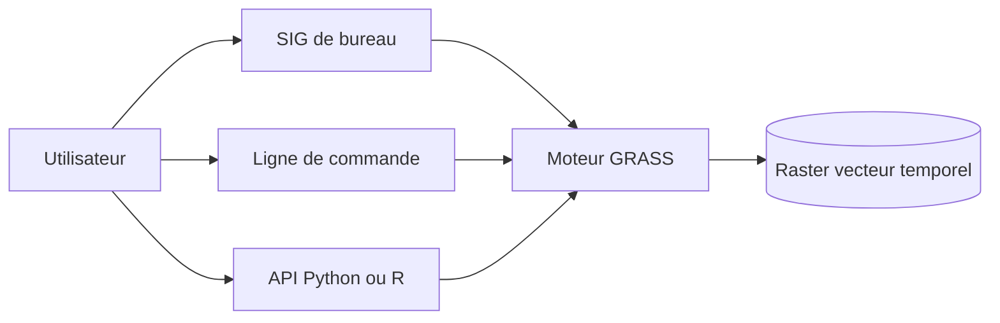

# OSGeo/grass

> Free GIS and engine for processing geospatial raster, vector and time-series data.

## The problem
Analyzing terrain, hydrology or imagery on large volumes calls for a scriptable geospatial engine.

## What it actually does
GRASS serves as a desktop GIS or a geoprocessing engine from the command line, Python or R. It covers terrain and ecosystem modeling, hydrology, data management and image processing. It includes a temporal framework and a Python API to analyze series. Hosted by OSGeo, sponsored by NumFOCUS.

## How it is wired
Simplified diagram based on the fiche, no diagram provided.

## Trying it
No command in the README: it points to the download page, to the INSTALL.md file for compiling, and to `docker/README.md` for Docker.

## Cost and gotchas
Free. Compilation is detailed in INSTALL.md and the wiki. Many open issues (719). The license is present but not identified by GitHub.

## What it is not
It is not a lightweight Python library: it is complete software with its own geographic database. The README gives no code example.

## Alternatives
No alternative named in the README.

## For you
Worth watching: keep in mind if you have geospatial series or imagery to process in Python; otherwise, outside your core field.
