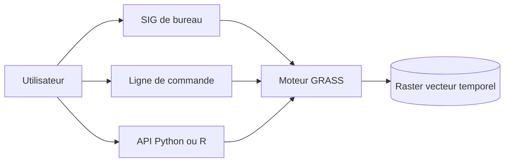

# OSGeo/grass

> Moteur et SIG libre pour traiter données raster, vecteur et séries temporelles géospatiales.

## Le problème
Analyser du terrain, de l'hydrologie ou de l'imagerie sur de gros volumes demande un moteur géospatial scriptable.

## Ce que ça fait vraiment
GRASS sert de SIG de bureau ou de moteur de géotraitement en ligne de commande, Python ou R. Il couvre la modélisation du terrain et des écosystèmes, l'hydrologie, la gestion de données et le traitement d'images. Il intègre un cadre temporel et une API Python pour analyser des séries. Hébergé par OSGeo, parrainé par NumFOCUS.

## Comment c'est branché
Schéma simplifié d'après la fiche, sans diagramme fourni.

## Essayer
Aucune commande dans le README : il renvoie à la page de téléchargement, au fichier INSTALL.md pour compiler, et à `docker/README.md` pour Docker.

## Coût et pièges
Gratuit. La compilation est détaillée dans INSTALL.md et le wiki. Beaucoup d'issues ouvertes (719). La licence est présente mais non identifiée par GitHub.

## Ce que ce n'est pas
Ce n'est pas une bibliothèque Python légère : c'est un logiciel complet avec sa propre base de données géographique. Le README ne donne aucun exemple de code.

## Alternatives
Aucune alternative nommée dans le README.

## Pour toi
À surveiller : à retenir si tu as des séries géospatiales ou de l'imagerie à traiter en Python ; sinon, hors de ton cœur de métier.

