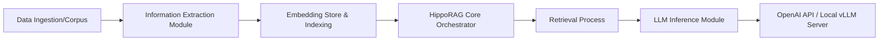

# OSU-NLP-Group/HippoRAG

> Long-term memory framework for LLMs, built on a knowledge graph, for researchers and RAG engineers.

## The problem
A classic RAG retrieves isolated passages and struggles with multi-hop questions or with summarizing long contexts.

## What it actually does
`HippoRAG` indexes documents: open information extraction (OpenIE) by an LLM, construction of a graph of entities and facts, storage of embeddings (Parquet by default, or Qdrant, ChromaDB, Milvus). At query time, retrieval follows the graph and then `rag_qa` answers. Possible LLMs: OpenAI, Azure, Bedrock (LiteLLM), OrcaRouter, or a local vLLM server. The author claims a lower indexing cost than GraphRAG, RAPTOR and LightRAG, with no figure in the README.

## How it is wired


## Trying it
```bash
conda create -n hipporag python=3.10
conda activate hipporag
pip install hipporag
export OPENAI_API_KEY=<your openai api key>
python main.py --dataset sample --llm_base_url https://api.openai.com/v1 --llm_name gpt-4o-mini --embedding_name nvidia/NV-Embed-v2
```

## Cost and gotchas
Indexing calls an LLM over the whole corpus: API cost or GPU. An index created without `index_manifest.json`, or with a different configuration, is rejected: you have to reindex into a new `save_dir`. OpenAI-compatible endpoints must return the `usage` data, otherwise HippoRAG rejects the response. Version 2.0.0a5: alpha.

## What it is not
It is not a ready-to-deploy search engine: it is research code (NeurIPS 2024, ICML 2025) with a reproduction script. The README results are the authors' own, on their datasets.

## Alternatives
- GraphRAG: the reference graph RAG, heavier to index according to the README.
- LightRAG: another graph RAG, compared by the authors.
- RAPTOR: hierarchical RAG, compared in the same way.

## For you
Worth watching: relevant if you are comparing graph RAGs on multi-hop questions, but alpha, costly to index and with no guarantee beyond the authors' evaluation; try it on a small corpus.
