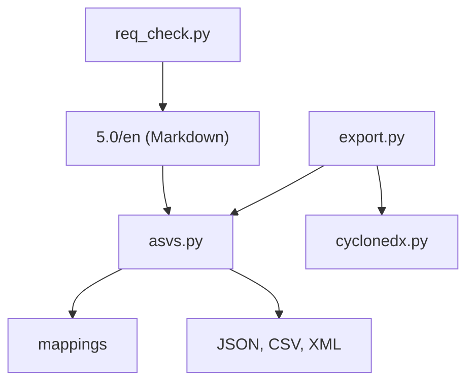

# OWASP/ASVS

> Open standard of application security requirements, for teams that design, develop and test web applications.

## The problem
Without a common reference, "secure" means nothing and every audit starts from a different list.

## What it actually does
- List of requirements numbered by chapter, section and requirement (for example v5.0.0-1.2.5).
- Stable version 5.0.0 (May 2025), published as PDF, Word and CSV, with translations.
- Python tools convert the Markdown chapters into JSON, CSV, XML and CycloneDX.
- Validators check the translations against the English.

## How it is wired

## Trying it
No command in the README: download the PDF, Word or CSV of version 5.0.0 from the links in the repository.

## Cost and gotchas
Free. Cite the version (`v5.0.0-1.2.5`) because identifiers change from one version to the next. CC-BY-SA license: share-alike.

## What it is not
Neither a scanner nor a testing tool: it is a reference to read and apply. The master branch is the working version, not the stable one.

## Alternatives
No alternative named in the README.

## For you
Adopt it as a review grid for any exposed API or ML application: it gives verifiable criteria, for free.
