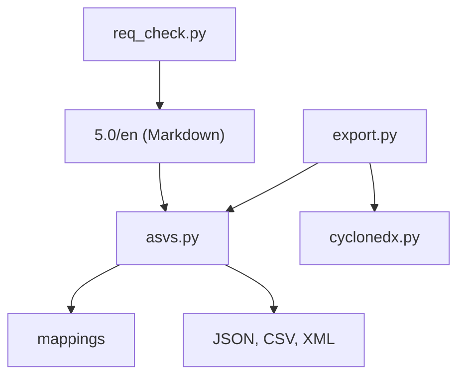

# OWASP/ASVS

> Standard ouvert d'exigences de sécurité applicative, pour équipes qui conçoivent, développent et testent des applications web.

## Le problème
Sans référentiel commun, « sécurisé » ne veut rien dire et chaque audit part d'une liste différente.

## Ce que ça fait vraiment
- Liste des exigences numérotées par chapitre, section et exigence (par exemple v5.0.0-1.2.5).
- Version stable 5.0.0 (mai 2025), publiée en PDF, Word et CSV, avec des traductions.
- Des outils Python convertissent les chapitres Markdown en JSON, CSV, XML et CycloneDX.
- Des validateurs vérifient les traductions contre l'anglais.

## Comment c'est branché

## Essayer
Pas de commande dans le README : on télécharge le PDF, Word ou CSV de la version 5.0.0 depuis les liens du dépôt.

## Coût et pièges
Gratuit. Citer la version (`v5.0.0-1.2.5`) car les identifiants changent d'une version à l'autre. Licence CC-BY-SA : partage à l'identique.

## Ce que ce n'est pas
Ni scanner ni outil de test : c'est un référentiel à lire et à appliquer. La branche master est la version de travail, pas la stable.

## Alternatives
Aucune alternative nommée dans le README.

## Pour toi
À adopter comme grille de revue pour toute API ou application ML exposée : il donne des critères vérifiables, gratuitement.

