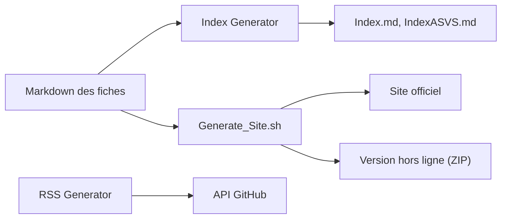

# OWASP/CheatSheetSeries

> OWASP application security best-practice cheat sheets, to be read on the official site.

## The problem
Developers look for reliable security practices, scattered across blogs and standards, without a concise reference per topic.

## What it actually does
The repository contains the Markdown sources of the cheat sheets, indexes (alphabetical, ASVS, MASVS, Proactive Controls) and scripts that generate the official site and an offline version. A script also produces an RSS feed from GitHub pull request data. The README states that the Markdown files are not to be cited: the reference is the site.

## How it is wired


## Trying it
```bash
make install-python-requirements
make generate-site
make serve
npm run lint-markdown
```

## Cost and gotchas
Free. CC-BY-SA-4.0 license: attribution and share-alike if you reuse the text. The repository files are not the citable version.

## What it is not
Not an audit tool nor a scanner: these are texts of recommendations. No guarantee of coverage for AI/ML uses: the README does not mention it.

## Alternatives
No alternative cited in the README.

## For you
Adopt as a security reference for your APIs and pipelines: free, maintained by a foundation, and directly applicable in code review.
