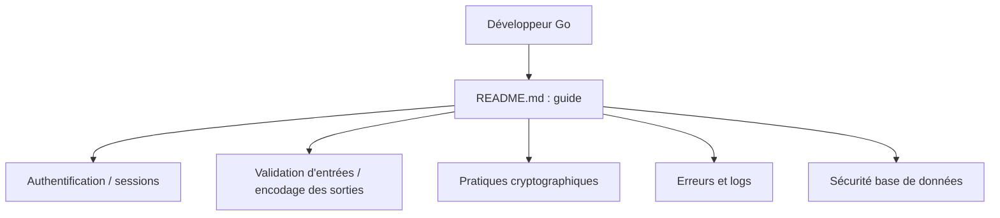

# OWASP/Go-SCP

> A book of secure coding best practices in Go for web applications, for developers to read.

## The problem
Writing web Go without knowing which security mistakes to watch for: input validation, sessions, crypto, errors.

## What it actually does
It is a book, not executable code. It follows the OWASP Secure Coding Practices guide (Quick Reference v2) chapter by chapter and illustrates it with Go examples. It is available as PDF, Mobi and ePub. Created by the Checkmarx team, then donated to the OWASP foundation.

## How it is wired

The provided graph proves no calls between chapters: these are reading themes.

## Trying it
```bash
# Aucune commande documentée : le README propose seulement de télécharger le livre (PDF, Mobi, ePub).
```

## Cost and gotchas
Free. Last push in May 2024: the content follows Quick Reference v2 and may be dated regarding Go versions and libraries.

## What it is not
Neither a library nor an analysis tool. It detects nothing in your code. CC-BY-SA license: share-alike if you reuse the text.

## Alternatives
- OWASP Secure Coding Practices Quick Reference Guide: the language-independent checklist, of which this book is the adaptation.

## For you
Worth watching: useful as a reference if you write Go services (model APIs, MLOps tools), but frozen since 2024 and impossible to run.
