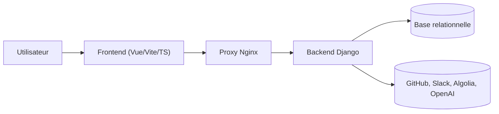

# OWASP/Nest

> Community platform to explore OWASP projects and find where to contribute, with a Slack bot and AI summaries.

## The problem
Finding your way through the many OWASP projects, chapters and issues is hard for a new contributor.

## What it actually does
Offers project and issue search, a chapter proximity page, a Slack bot (NestBot) and AI-generated summaries. From the code: modular Django backend (apps `core`, `github`, `owasp`, `slack`, `common`), Vue/TypeScript frontend, calls to GitHub, Slack, Algolia and OpenAI, deployment with Docker Compose and Ansible.

## How it is wired

## Trying it
The README gives no command: it points to external documentation (DeepWiki, ReadTheDocs).

## Cost and gotchas
The backend calls OpenAI and Algolia (accounts and keys at your expense) and GitHub/Slack. Multi-container deployment. 460 open issues.

## What it is not
It is not a security tool: it is a community contribution portal.

## Alternatives
The README cites no alternative.

## For you
Worth watching: a concrete architecture of a Django app with search, Slack bot and AI summaries, useful as a reference if you contribute to OWASP.
