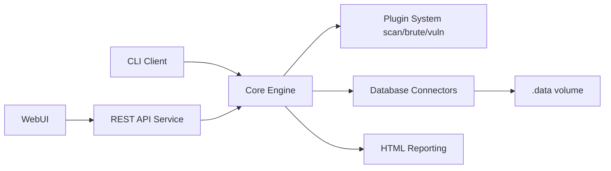

# OWASP/Nettacker

> Python framework for automated network auditing, for security professionals testing systems they have the right to audit.

## The problem
Mapping the hosts, ports, subdomains and services of a perimeter by hand is slow and hard to repeat. Without history, you cannot see what changed from one audit to the next.

## What it actually does
Each task (port scan, service discovery, subdomain enumeration, vulnerability checks, credential tests) is a YAML module loaded by a shared, multithreaded engine. Targets: IPs, ranges, CIDRs, domains, URLs. Results go to a database (SQLite by default, MySQL/PostgreSQL possible) and to HTML, JSON, CSV or text reports. A comparison with previous scans is used to spot drift. Use is strictly reserved for systems you have written authorization to audit; the README reminds you of this at the top.

## How it is wired


## Trying it
```bash
docker run owasp/nettacker -i 192.168.0.1 -m port_scan
docker run owasp/nettacker --help
docker-compose up
```

## Cost and gotchas
Free, Docker image available. The Web mode API key is displayed in the console (`docker logs nettacker_nettacker`). No scan without the target owner's consent: legal responsibility lies with the operator.

## What it is not
Neither a data science tool nor a continuous monitoring tool: it is an audit scanner. The README also mentions stealth options (delays, proxy) that make the legal framework all the more important. 248 open issues.

## Alternatives
No alternative named in the README.

## For you
Watch: useful only if you audit your own exposed ML infrastructure (port drift in CI/CD), outside the data/AI core otherwise.
