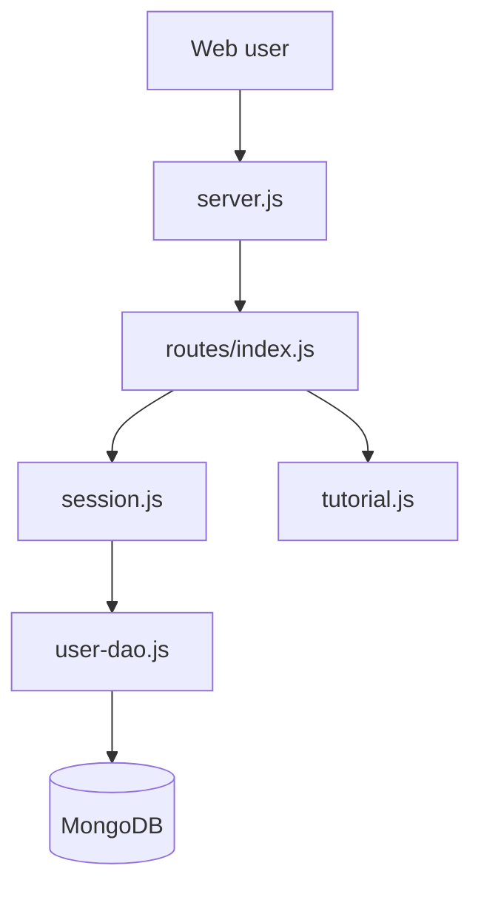

# OWASP/NodeGoat

> Deliberately vulnerable Node.js application for learning the OWASP Top 10 by exploiting and then fixing it.

## The problem
Understanding OWASP flaws on Node.js is abstract without a real application to attack.

## What it actually does
An Express app with MongoDB (profile, contributions, allocations, memos, search) deliberately riddled with flaws. A tutorial page explains each risk; test accounts are provided.

## How it is wired
Diagram based on the supplied diagram.



## Trying it
```bash
git clone https://github.com/OWASP/NodeGoat.git
cd NodeGoat
npm install
npm run db:seed
npm start
```

## Cost and gotchas
Free; local MongoDB, Atlas or Docker. Never expose it on the Internet: the application is vulnerable by design.

## What it is not
Not an example of safe code to copy. Last push in June 2024, with 119 open issues.

## Alternatives
No alternative named in the README.

## For you
Worth watching: a good aid for teaching web security, but little related to your data/AI work.
