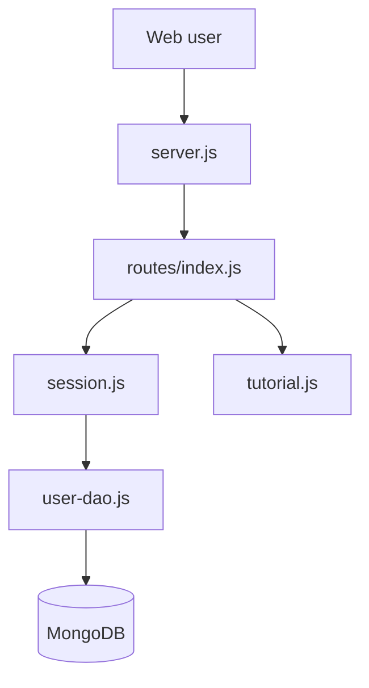

# OWASP/NodeGoat

> Application Node.js volontairement vulnérable pour apprendre l'OWASP Top 10 en l'exploitant puis en la corrigeant.

## Le problème
Comprendre les failles OWASP sur Node.js est abstrait sans application réelle à attaquer.

## Ce que ça fait vraiment
Une appli Express avec MongoDB (profil, contributions, allocations, mémos, recherche) volontairement truffée de failles. Une page tutoriel explique chaque risque ; des comptes de test sont fournis.

## Comment c'est branché
Schéma d'après le diagramme fourni.



## Essayer
```bash
git clone https://github.com/OWASP/NodeGoat.git
cd NodeGoat
npm install
npm run db:seed
npm start
```

## Coût et pièges
Gratuit ; MongoDB local, Atlas ou Docker. Ne jamais exposer sur Internet : l'application est vulnérable par conception.

## Ce que ce n'est pas
Pas un exemple de code sûr à copier. Dernier push en juin 2024, avec 119 issues ouvertes.

## Alternatives
Aucune alternative nommée dans le README.

## Pour toi
À surveiller : bon support pour former à la sécurité web, mais peu lié à ton métier data/IA.

