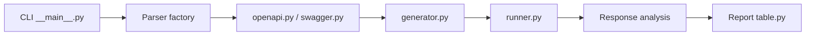

# OWASP/OFFAT

> API security tester that generates its tests from an OpenAPI specification, for teams auditing their own APIs.

## The problem
Manually checking that an API follows OWASP best practices is slow and repetitive, endpoint by endpoint.

## What it actually does
- Reads a Swagger v2 or OpenAPI v3 specification and generates tests, with data supplied through a YAML file.
- Runs requests asynchronously and analyzes responses (restricted HTTP methods, data exposure, access control, basic injections, etc.).
- Produces a table report; available as a CLI, an automation API and in Docker.

## How it is wired


## Trying it
```bash
python -m pip install offat
offat -f swagger_file.json
```

## Cost and gotchas
Free, MIT license. Run it only on APIs you own or have written authorization for: the tests send real requests. Detailed options are deferred to the full README.

## What it is not
Not a complete audit: only part of the OWASP API Top 10 is covered. The "result" column can show a success even when data is leaking (the README states this).

## Alternatives
No alternative named in the README.

## For you
Worth watching: handy for testing in CI the APIs that serve your models, as long as you use it on your own environments; partial coverage means you must complement it.
