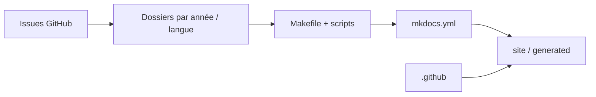

# OWASP/Top10

> Official repository of the OWASP Top 10 document on web application risks, for developers and security teams.

## The problem
Without a shared reference, everyone prioritizes web security risks their own way and audits cannot be compared.

## What it actually does
It hosts the editions of the Top 10: 2025 published (final), 2021 superseded, 2017 historical (PPTX, PDF). The code shows folders by year and by language, scripts, a Makefile and `mkdocs.yml` that generate a static site. Five co-leads are named. No software to run.

## How it is wired

## Trying it
No documented command: read the published documents (Top10:2025) from the links in the README.

## Cost and gotchas
Free. The license is present but not identified by GitHub: check before reusing the content.

## What it is not
Neither a scanner nor a tool: a reference document. Older editions remain in the repository; do not cite 2017 or 2021 as current.

## Alternatives
No alternative named in the README.

## For you
To adopt as a reference: if you expose model APIs or AI apps, these are the risk categories to check off before going to production.
