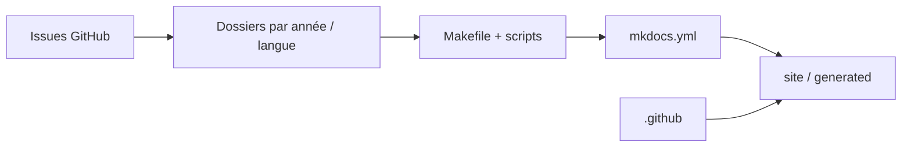

# OWASP/Top10

> Dépôt officiel du document OWASP Top 10 des risques applicatifs web, pour développeurs et équipes sécurité.

## Le problème
Sans référentiel commun, chacun priorise les risques de sécurité web à sa façon et les audits ne sont pas comparables.

## Ce que ça fait vraiment
Il héberge les éditions du Top 10 : 2025 publiée (finale), 2021 remplacée, 2017 historique (PPTX, PDF). Le code montre des dossiers par année et par langue, des scripts, un Makefile et `mkdocs.yml` qui génèrent un site statique. Cinq co-leaders sont cités. Aucun logiciel à exécuter.

## Comment c'est branché

## Essayer
Aucune commande documentée : lire les documents publiés (Top10:2025) depuis les liens du README.

## Coût et pièges
Gratuit. La licence est présente mais non identifiée par GitHub : vérifier avant de réutiliser le contenu.

## Ce que ce n'est pas
Ni un scanner ni un outil : un document de référence. Les éditions anciennes restent dans le dépôt, ne pas citer 2017 ou 2021 comme courant.

## Alternatives
Aucune alternative nommée dans le README.

## Pour toi
À adopter comme référence : si tu exposes des API de modèles ou des apps IA, ce sont les catégories de risque à cocher avant mise en production.

