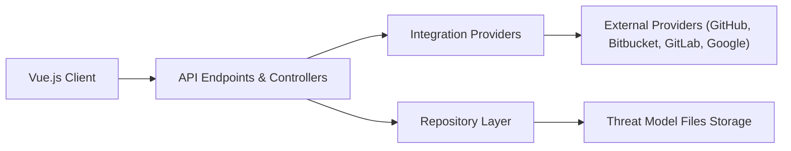

# OWASP/threat-dragon

> Threat modeling application: draw a flow diagram and list the threats per element.

## The problem
Threat modeling a system is done in spreadsheets or scattered diagrams, with no link between the diagram and the risk list.

## What it actually does
Data flow diagram editor (Vue.js) with threat suggestions and entry of mitigation measures. Web version (Node/Express server) that stores models locally or in GitHub, GitLab, Bitbucket, GitHub Enterprise; desktop version for Windows, macOS, Linux with no external repository. OWASP project at "Production" status, 1.x branch in maintenance only.

## How it is wired


## Trying it
```bash
git clone https://github.com/owasp/threat-dragon.git
npm install
npm start
docker run -it --rm -p 8080:3000 -v $(pwd)/.env:/app/.env threatdragon/owasp-threat-dragon:v2.2.0
```
Then http://localhost:8080/.

## Cost and gotchas
Free; environment variables to configure, and an OAuth application to register to access GitHub, GitLab or Bitbucket. The `latest` tag may be a development version: prefer `stable`.

## What it is not
Not a vulnerability scanner: it structures thinking, it detects nothing.

## Alternatives
No alternative named in the README.

## For you
Worth watching: useful for documenting the risks of an ML system or a data platform, but a security analysis tool, not a data engineering one.
