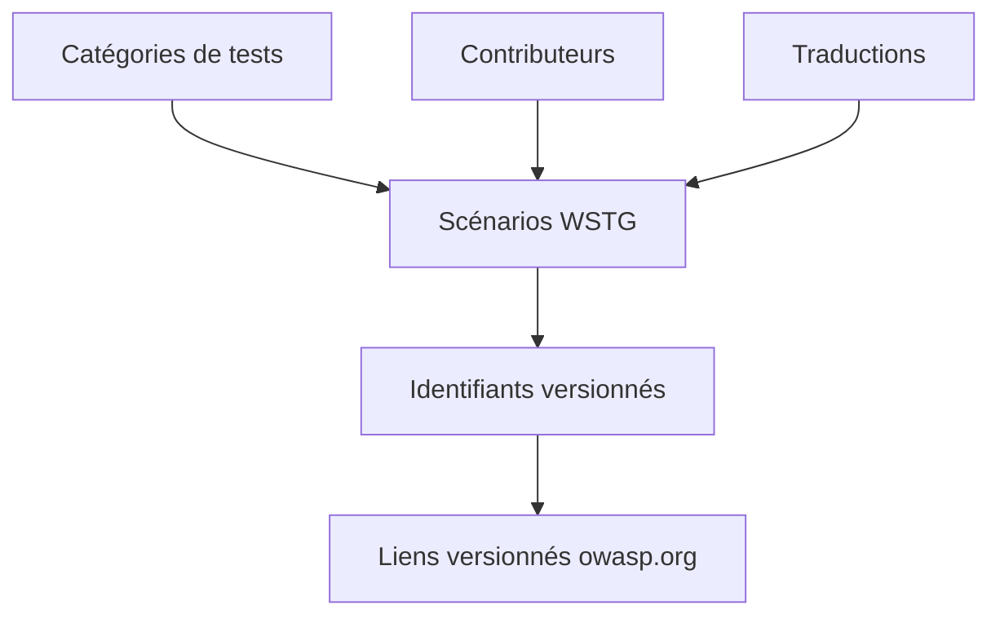

# OWASP/wstg

> OWASP reference guide for testing the security of web applications and services, for penetration testers and teams.

## The problem
Testing the security of a web application without a common method leaves gaps and uneven reports.

## What it actually does
The guide documents numbered test scenarios (WSTG-INFO-02, etc.) by category. It offers a versioned reference rule (WSTG-v42-INFO-02) and stable links. Version 5.0 is in progress, 4.2 is the latest stable; translations exist.

## How it is wired
Simplified diagram based on the sheet, no diagram provided.

## Trying it
No documented command: read the guide on GitHub or online (release 4.2); contribute via the contribution guide.

## Cost and gotchas
Free. CC-BY-SA-4.0 license: any reuse requires attribution and sharing under the same terms. Identifiers may change between versions.

## What it is not
Not a scanner or an automatic tool: it is a written methodology that you must apply yourself with other tools.

## Alternatives
No alternative named in the README.

## For you
Adopt as a checklist when you expose an API or an AI application: a recognized, free and versioned reference.
