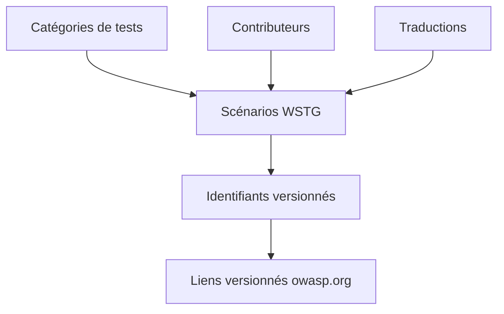

# OWASP/wstg

> Guide de référence OWASP pour tester la sécurité des applications et services web, pour testeurs d'intrusion et équipes.

## Le problème
Tester la sécurité d'une application web sans méthode commune laisse des trous et des rapports inégaux.

## Ce que ça fait vraiment
Le guide documente des scénarios de test numérotés (WSTG-INFO-02, etc.) par catégorie. Il propose une règle de référence versionnée (WSTG-v42-INFO-02) et des liens stables. La version 5.0 est en cours, la 4.2 est la dernière stable ; des traductions existent.

## Comment c'est branché
Schéma simplifié d'après la fiche, sans diagramme fourni.

## Essayer
Aucune commande documentée : lire le guide sur GitHub ou en ligne (release 4.2) ; contribuer via le guide de contribution.

## Coût et pièges
Gratuit. Licence CC-BY-SA-4.0 : toute réutilisation exige l'attribution et le partage dans les mêmes conditions. Les identifiants peuvent changer entre versions.

## Ce que ce n'est pas
Pas un scanner ni un outil automatique : c'est une méthodologie rédigée, qu'il faut appliquer soi-même avec d'autres outils.

## Alternatives
Aucune alternative nommée dans le README.

## Pour toi
À adopter comme checklist quand tu exposes une API ou une application d'IA : référence reconnue, gratuite et versionnée.

