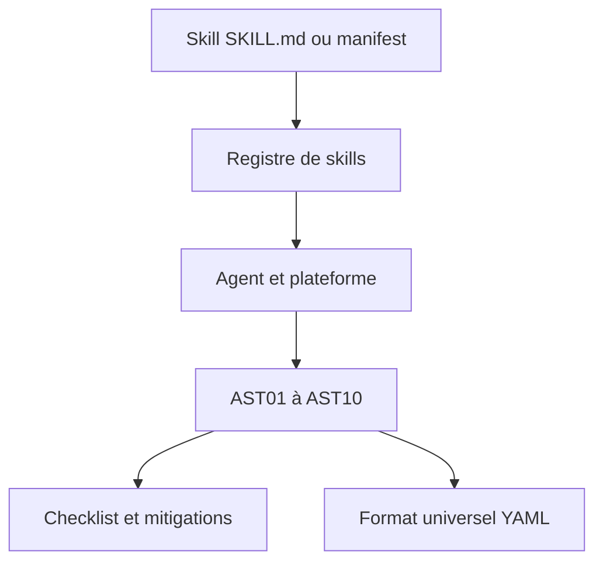

# OWASP/www-project-agentic-skills-top-10

> An OWASP Top 10 of security risks for AI agent "skills", for security and platform teams.

## The problem
Agent skills (SKILL.md, manifests) run with the agent's privileges and nobody audits them. Registries have already been poisoned.

## What it actually does
A reference document, not code: ten risks (AST01 to AST10) with severity, mitigations and public evidence (ClawHavoc campaign, Snyk audit, Claude Code CVE). It also offers a checklist, a universal skill format in YAML and a mapping to the MAESTRO model. Version 1.0 in public review phase.

## How it is wired
Simplified diagram based on the sheet, no diagram provided.



## Trying it
```bash
# Aucune commande documentée : lire le site
# https://owasp.github.io/www-project-agentic-skills-top-10/
```

## Cost and gotchas
Free. License announced as CC BY-SA 4.0 in the README but not identified by GitHub. The figures cited come from third-party studies and the project is still under review.

## What it is not
Not a scanner or an executable tool. The universal format is a proposal, not an adopted standard. It covers skills, not model security or the MCP protocol.

## Alternatives
- OWASP LLM Top 10: covers the model, not the skills layer.
- OWASP MCP Top 10: covers the protocol, not what skills do with it.

## For you
Worth watching: if you publish or install agent skills, the risk grid is useful for a review, but wait for the final version before relying on it.
