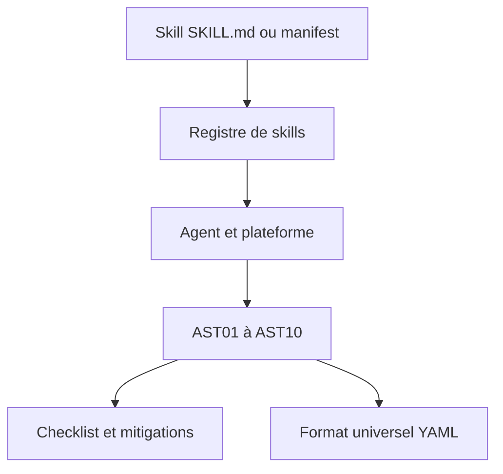

# OWASP/www-project-agentic-skills-top-10

> Un Top 10 OWASP des risques de sécurité des « skills » d'agents IA, pour les équipes sécurité et plateforme.

## Le problème
Les skills d'agents (SKILL.md, manifestes) s'exécutent avec les droits de l'agent et personne ne les audite. Les registres ont déjà été empoisonnés.

## Ce que ça fait vraiment
Un document de référence, pas du code : dix risques (AST01 à AST10) avec sévérité, mitigations et preuves publiques (campagne ClawHavoc, audit Snyk, CVE Claude Code). Il propose aussi une checklist, un format de skill universel en YAML et un mapping vers le modèle MAESTRO. Version 1.0 en phase de relecture publique.

## Comment c'est branché
Schéma simplifié d'après la fiche, sans diagramme fourni.



## Essayer
```bash
# Aucune commande documentée : lire le site
# https://owasp.github.io/www-project-agentic-skills-top-10/
```

## Coût et pièges
Gratuit. Licence annoncée CC BY-SA 4.0 dans le README mais non identifiée par GitHub. Les chiffres cités viennent d'études tierces et le projet est encore en relecture.

## Ce que ce n'est pas
Pas un scanner ni un outil exécutable. Le format universel est une proposition, pas un standard adopté. Il couvre les skills, pas la sécurité du modèle ni du protocole MCP.

## Alternatives
- OWASP LLM Top 10 : couvre le modèle, pas la couche skills.
- OWASP MCP Top 10 : couvre le protocole, pas ce que les skills en font.

## Pour toi
À surveiller : si tu publies ou installes des skills d'agents, la grille de risques est utile pour une revue, mais attends la version finale avant de t'y référer.

