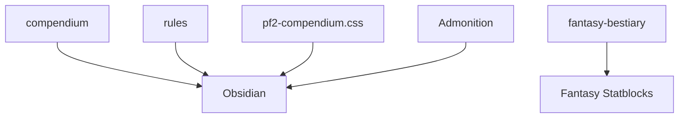

# Obsidian-TTRPG-Community/Pathfinder-2E-SRD-Markdown

> Pathfinder 2E rules and compendium in Markdown for Obsidian, for players and game masters.

## The problem
Browsing the Pathfinder 2E rules in Obsidian requires structured, well-formatted content.

## What it actually does
An Obsidian vault with `compendium` (spells, items), `rules`, a bestiary for Fantasy Statblocks and a CSS snippet. It requires the Admonition and Fantasy Statblocks plugins. The content is used under Paizo's Community Use Policy, which forbids charging for access.

## How it is wired
Simplified diagram based on the sheet, no diagram provided.

## Trying it
No command documented: you open the repository as an Obsidian vault.

## Cost and gotchas
Free. Without the admonitions, the rendering is "ugly" according to the README. A license is present but unidentified, and non-commercial use is imposed by Paizo.

## What it is not
Not a game tool: it is content. The Markdown bestiary is not yet in the compendium.

## Alternatives
None cited in the README.

## For you
Ignore: role-playing games unrelated to your work, and content under a restrictive license.
