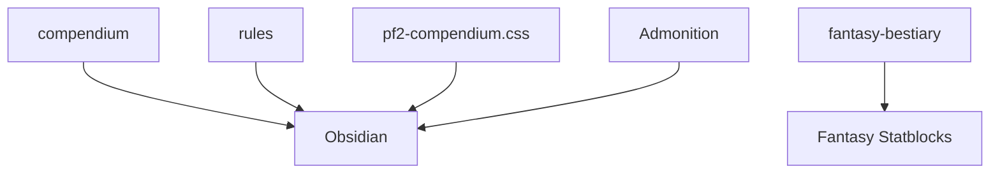

# Obsidian-TTRPG-Community/Pathfinder-2E-SRD-Markdown

> Règles et compendium Pathfinder 2E en Markdown pour Obsidian, pour joueurs et maîtres de jeu.

## Le problème
Consulter les règles Pathfinder 2E dans Obsidian demande un contenu structuré et mis en forme.

## Ce que ça fait vraiment
Un coffre Obsidian avec `compendium` (sorts, objets), `rules`, un bestiaire pour Fantasy Statblocks et un snippet CSS. Il demande les modules Admonition et Fantasy Statblocks. Le contenu est utilisé sous la politique d'usage communautaire de Paizo, qui interdit de faire payer l'accès.

## Comment c'est branché
Schéma simplifié d'après la fiche, sans diagramme fourni.

## Essayer
Aucune commande documentée : on ouvre le dépôt comme coffre Obsidian.

## Coût et pièges
Gratuit. Sans les admonitions, le rendu est « laid » selon le README. Licence présente non identifiée, et usage non commercial imposé par Paizo.

## Ce que ce n'est pas
Pas un outil de jeu : c'est du contenu. Le bestiaire Markdown n'est pas encore dans le compendium.

## Alternatives
Aucune citée dans le README.

## Pour toi
À ignorer : jeu de rôle sans lien avec ton travail, et un contenu sous licence restrictive.

