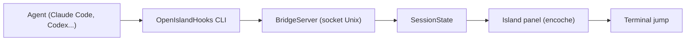

# Octane0411/open-vibe-island

> Local macOS app, in the notch or the top bar, that tracks and controls your coding agents.

## The problem
With several coding agents open in terminals, you lose track of their state, of permission requests and of the right window to go back to.

## What it actually does
The agents' hooks (Claude Code, Codex, Cursor, Gemini CLI, OpenCode, Kimi, Grok, Pi…) call a small CLI, `OpenIslandHooks`, which sends JSON over a Unix socket to a `BridgeServer` in the app. Session state is reduced by `SessionState.apply` and shown in the overlay; a click takes you back to the right terminal or IDE. It also reads the 5-hour and 7-day usage windows of Claude and Codex. The hooks fail open: without the app, the agents keep running.

## How it is wired


## Trying it
```bash
brew install --cask open-island
git clone https://github.com/Octane0411/open-vibe-island.git
swift run OpenIslandSetup install
```

## Cost and gotchas
Free, with no telemetry or account according to the README. macOS 14 minimum; building requires Swift 6.2 and Xcode. Installation modifies the agents' config files (`~/.claude/settings.json`, `~/.codex/config.toml`…). GPL-3.0.

## What it is not
Not an orchestration layer: it observes and redirects, without launching the agents. Claude Desktop usage alone does not feed the usage panel. macOS only. 208 open issues.

## Alternatives
- Vibe Island: the closed, paid version whose free equivalent it aims to be.

## For you
Worth watching: useful if you juggle several coding agents on a Mac, but its hooks touch your agent configs, so test it first.
