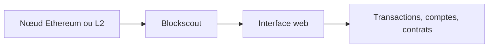

# OffchainLabs/blockscout

> Open-source block explorer for EVM chains, L2s and test networks.

## The problem
Inspecting the transactions, accounts and contracts of an EVM chain without depending on a closed explorer such as Etherscan.

## What it actually does
A web interface to search transactions, view accounts and balances, and verify and interact with contracts. It works with Ethereum, Ethereum Classic, Optimism, Gnosis and private L2s or sidechains. Installation is via Ansible or manual; details are in the external documentation.

## How it is wired
Simplified diagram based on the sheet, no diagram provided.

## Trying it
No command in the README: it points to the documentation (Ansible, manual deployment, environment variables).

## Cost and gotchas
You need to host a node and a database. GPL-3.0: copyleft. This repository is a version of the project by Offchain Labs.

## What it is not
Not a tool for large-scale on-chain data analysis.

## Alternatives
Etherscan and Etherchain (centralized explorers mentioned).

## For you
Ignore: blockchain explorer, outside data/AI/MLOps.
