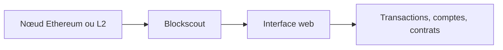

# OffchainLabs/blockscout

> Explorateur de blocs open source pour chaînes EVM, L2 et réseaux de test.

## Le problème
Inspecter transactions, comptes et contrats d'une chaîne EVM sans dépendre d'un explorateur fermé comme Etherscan.

## Ce que ça fait vraiment
Interface web pour chercher des transactions, voir comptes et soldes, vérifier et interagir avec des contrats. Fonctionne avec Ethereum, Ethereum Classic, Optimism, Gnosis et des L2 ou sidechains privés. Installation par Ansible ou manuelle ; détails dans la documentation externe.

## Comment c'est branché
Schéma simplifié d'après la fiche, sans diagramme fourni.

## Essayer
Aucune commande dans le README : renvoi à la documentation (Ansible, déploiement manuel, variables d'environnement).

## Coût et pièges
Il faut héberger un nœud et une base. GPL-3.0 : copyleft. Ce dépôt est une version du projet par Offchain Labs.

## Ce que ce n'est pas
Pas un outil d'analyse de données on-chain à grande échelle.

## Alternatives
Etherscan et Etherchain (explorateurs centralisés cités).

## Pour toi
À ignorer : explorateur blockchain, hors data/IA/MLOps.

