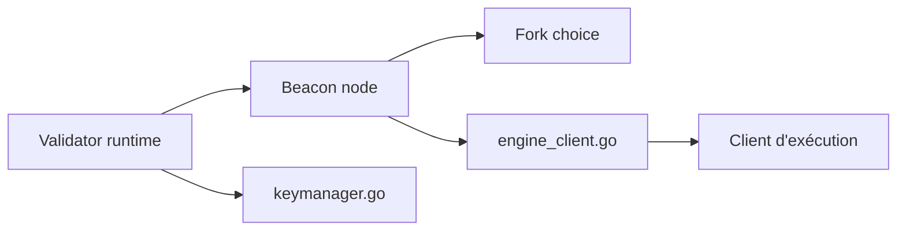

# OffchainLabs/prysm

> Go implementation of the Ethereum consensus layer (beacon node and validator), developed by Offchain Labs.

## The problem
Participating in Ethereum under proof of stake requires a consensus-layer client.

## What it actually does
Beacon node (synchronization, fork choice, state transitions, API) and validator runtime (key management, remote signer). Slasher, light client and database in the tree. Installation and usage point to a documentation portal; the README gives few details.

## How it is wired

## Trying it
No command documented in the README (it points to the official documentation).

## Cost and gotchas
Free, but staking commits real funds (launched via the Ethereum launchpad). An execution client is required.

## What it is not
Not an execution client. The README mentions instruction files for coding agents (`.agents/AGENTS.md`).

## Alternatives
None cited in the README.

## For you
Operating an Ethereum validator has no link with a data/AI profile: ignore.
