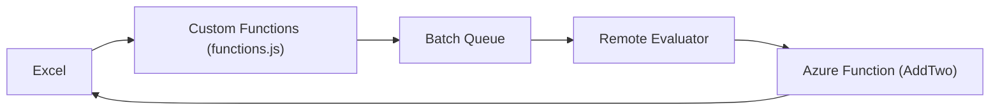

# OfficeDev/Office-Add-in-samples

> Collection of Office add-in samples (Excel, Outlook, Word, PowerPoint) to learn how to build them.

## The problem
Writing an Office add-in requires understanding the manifest, task pane, authentication and the Office.js API.

## What it actually does
A catalog of samples: "hello world" per application, completed tutorials, Blazor WebAssembly, authentication and SSO (MSAL, NAA, Microsoft Graph), Outlook event-based activation, Excel custom functions (batching, web worker, Azure Function), shared runtime, VSTO migration. The generated diagram only covers some of the folders.

## How it is wired

## Trying it
No commands in this README: each sample has its own documentation, with Microsoft's guides and tutorials.

## Cost and gotchas
Free; a Microsoft 365 account (developer program possible) is needed for testing. Some features are in public preview.

## What it is not
Not an installable library: samples to read and copy.

## Alternatives
The README cites no alternatives.

## For you
Ignore, unless you build Excel add-ins to distribute results: otherwise no link with a data/AI/MLOps flow.
