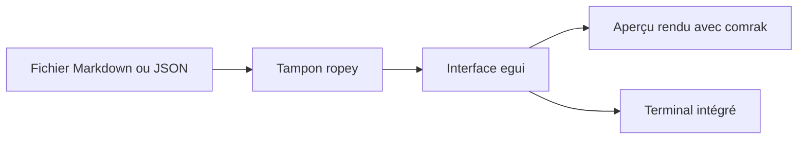

# OlaProeis/Ferrite

> A desktop editor in Rust and egui for Markdown, JSON, YAML and TOML.

## The problem
Web or Electron editors are heavy for opening large Markdown or configuration files.

## What it actually does
Native editor with raw, rendered and split modes, a tree view for JSON, YAML and TOML, a CSV view, eleven types of Mermaid diagrams, an integrated terminal and PDF or HTML export. Shell or Python code blocks can be run from the preview (option to enable). The code is written entirely by Claude, according to the README.

## How it is wired
Simplified diagram based on the card, no diagram provided.



## Trying it
```bash
git clone https://github.com/OlaProeis/Ferrite.git
cd Ferrite
cargo build --release
ferrite path/to/file.md
```

## Cost and gotchas
Free. On macOS, builds are not signed or notarized: you must remove the quarantine. On Ubuntu 24.04 with Wayland, the keyboard does not work without forcing X11.

## What it is not
Not a data tool: it is a text editor. macOS remains experimental according to the README.

## Alternatives
No alternative named in the README.

## For you
Ignore: it is a text editor that brings nothing to a data or MLOps workflow that your current editor does not already give you.
