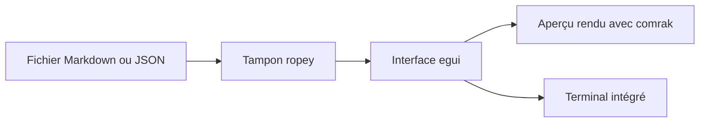

# OlaProeis/Ferrite

> Un éditeur de bureau en Rust et egui pour Markdown, JSON, YAML et TOML.

## Le problème
Les éditeurs web ou Electron sont lourds pour ouvrir de gros fichiers Markdown ou de configuration.

## Ce que ça fait vraiment
Éditeur natif avec modes brut, rendu et partagé, arbre pour JSON, YAML et TOML, vue CSV, onze types de diagrammes Mermaid, terminal intégré et export PDF ou HTML. Les blocs de code shell ou Python s'exécutent depuis l'aperçu (option à activer). Le code est écrit entièrement par Claude, selon le README.

## Comment c'est branché
Schéma simplifié d'après la fiche, sans diagramme fourni.



## Essayer
```bash
git clone https://github.com/OlaProeis/Ferrite.git
cd Ferrite
cargo build --release
ferrite path/to/file.md
```

## Coût et pièges
Gratuit. Sur macOS, les builds ne sont pas signés ni notarisés : il faut retirer la quarantaine. Sous Ubuntu 24.04 avec Wayland, le clavier ne marche pas sans forcer X11.

## Ce que ce n'est pas
Pas un outil de données : c'est un éditeur de texte. macOS reste expérimental selon le README.

## Alternatives
Aucune alternative nommée dans le README.

## Pour toi
À ignorer : c'est un éditeur de texte qui n'apporte rien à un flux data ou MLOps que tu n'as pas déjà dans ton éditeur actuel.

