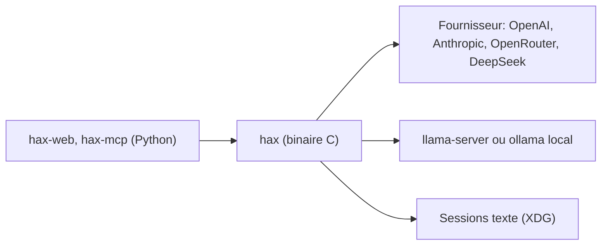

# OleksandrChekhovskyi/hax

> Minimalist coding agent in C for the terminal, which works well with local models.

## The problem
Coding agents are heavy, chain permission prompts and plugins, and leave little RAM for local models.

## What it actually does
A single C binary that talks to OpenAI, Anthropic, OpenRouter, DeepSeek, llama.cpp, Ollama or a compatible endpoint. It renders streaming Markdown, keeps native scrolling, lets you review the exchanges (Ctrl+T) and saves sessions as text files. No plugins or built-in MCP.

## How it is wired
Simplified diagram based on the sheet, no diagram provided.



## Trying it
```sh
brew install oleksandrchekhovskyi/hax/hax
hax -p "list TODOs"
hax -c
```

## Cost and gotchas
Free, but remote providers require their key and bill per usage. The BSDs are built from source; Windows goes through WSL.

## What it is not
Not a rich agent: no MCP marketplace, plugins, IDE panels or per-command permission requests, by deliberate choice.

## Alternatives
No alternative cited in the README.

## For you
Watch: interesting for testing local models with few resources, but young and with a single maintainer.
