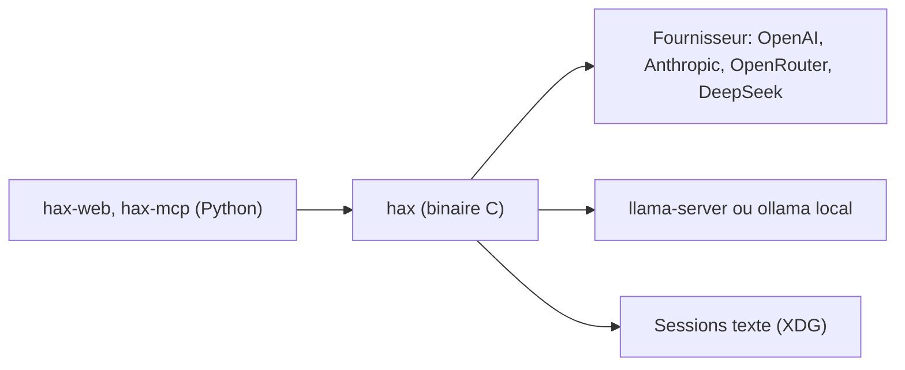

# OleksandrChekhovskyi/hax

> Agent de code minimaliste en C pour le terminal, qui marche bien avec des modèles locaux.

## Le problème
Les agents de code sont lourds, enchaînent invites de permissions et plugins, et laissent peu de RAM aux modèles locaux.

## Ce que ça fait vraiment
Un binaire C unique qui discute avec OpenAI, Anthropic, OpenRouter, DeepSeek, llama.cpp, Ollama ou un endpoint compatible. Il affiche le Markdown en flux, garde le défilement natif, permet de relire les échanges (Ctrl+T) et sauve des sessions en fichiers texte. Pas de plugins ni de MCP intégré.

## Comment c'est branché
Schéma simplifié d'après la fiche, sans diagramme fourni.



## Essayer
```sh
brew install oleksandrchekhovskyi/hax/hax
hax -p "list TODOs"
hax -c
```

## Coût et pièges
Gratuit, mais les fournisseurs distants demandent leur clé et facturent à l'usage. Les BSD se compilent depuis les sources ; Windows passe par WSL.

## Ce que ce n'est pas
Pas un agent riche : pas de marketplace MCP, de plugins, de panneaux IDE ni de demandes de permission par commande, par choix assumé.

## Alternatives
Aucune alternative citée dans le README.

## Pour toi
Surveiller : intéressant pour tester des modèles locaux avec peu de ressources, mais jeune et à mainteneur unique.

