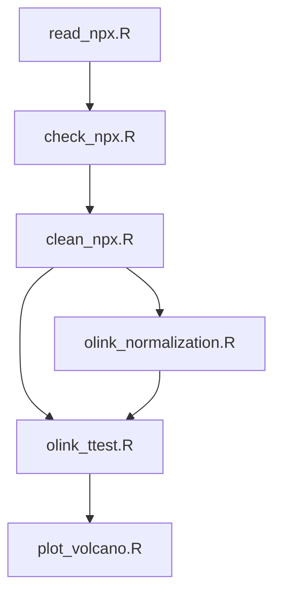

# Olink-Proteomics/OlinkRPackage

> CRAN R package to read, check, normalize and analyze Olink NPX proteomics data.

## The problem
Olink NPX exports require repetitive processing and statistical tests.

## What it actually does
`OlinkAnalyze` reads NPX files, checks and cleans them, then normalizes them across projects (bridge samples). It provides tests (t-test, ANOVA), quality control plots, volcano and PCA. Two simulated datasets are included.

## How it is wired
Diagram based on the code diagram.



## Trying it
```bash
conda create -n OlinkAnalyze -c conda-forge r-olinkanalyze
# Dans R : install.packages("OlinkAnalyze")
# OlinkAnalyze::read_NPX(filename = "path/to/my_NPX_data.xlsx")
```

## Cost and gotchas
Free. AGPL-3.0 license (strong copyleft). Only useful with Olink data, hence access to their platform.

## What it is not
Not a generic proteomics tool: it is designed for Olink's NPX format.

## Alternatives
None cited in the README.

## For you
Ignore: specific to Olink proteomics, only worth a look if you work on this data.
