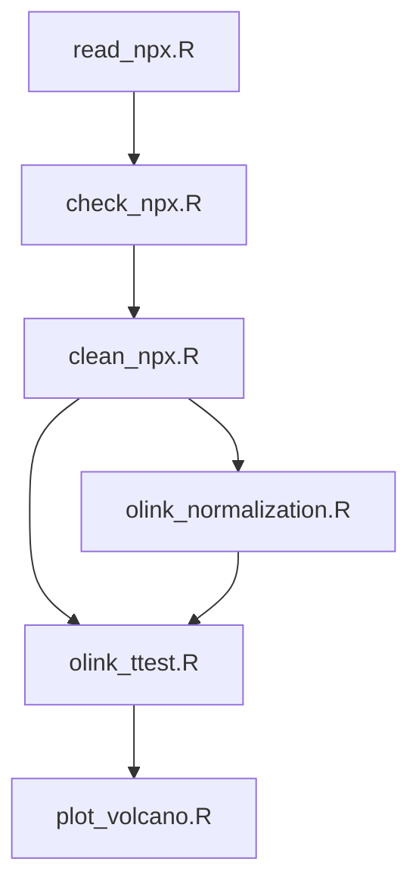

# Olink-Proteomics/OlinkRPackage

> Paquet R CRAN pour lire, contrôler, normaliser et analyser les données de protéomique Olink NPX.

## Le problème
Les exports NPX d'Olink demandent un traitement et des tests statistiques répétitifs.

## Ce que ça fait vraiment
`OlinkAnalyze` lit les fichiers NPX, les vérifie et les nettoie, puis les normalise entre projets (échantillons pont). Il fournit tests (t-test, ANOVA), graphiques de contrôle qualité, volcano et PCA. Deux jeux simulés sont inclus.

## Comment c'est branché
Schéma d'après le diagramme du code.



## Essayer
```bash
conda create -n OlinkAnalyze -c conda-forge r-olinkanalyze
# Dans R : install.packages("OlinkAnalyze")
# OlinkAnalyze::read_NPX(filename = "path/to/my_NPX_data.xlsx")
```

## Coût et pièges
Gratuit. Licence AGPL-3.0 (copyleft fort). Utile seulement avec des données Olink, donc un accès à leur plateforme.

## Ce que ce n'est pas
Pas un outil de protéomique générique : il est conçu pour le format NPX d'Olink.

## Alternatives
Aucune citée dans le README.

## Pour toi
Ignorer : spécifique à la protéomique Olink, à ne regarder que si tu travailles sur ces données.

