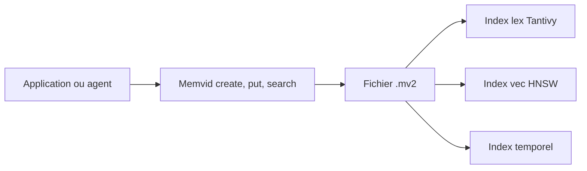

# Olow304/memvid

> Memory layer for AI agents in a single portable file, with no database to run.

## The problem
Giving an agent long-term memory forces you to operate a vector database or a RAG pipeline.

## What it actually does
A `.mv2` file contains a header, a write-ahead log, compressed segments ("Smart Frames", append-only), a full-text index (Tantivy), a vector index (HNSW) and a time index. Search, timeline and return to a past state. Optional features: PDF, CLIP, Whisper, local ONNX or OpenAI embeddings, encryption. Rust, Node and Python SDKs and a CLI.

## How it is wired


## Trying it
```bash
pip install memvid-sdk
cargo add memvid-core
cargo run --example basic_usage
```

## Cost and gotchas
Free; Rust 1.85+ to compile. Local embedding models must be downloaded by hand (BGE-small, about 120 MB). OpenAI requires a key.

## What it is not
The README's benchmark figures (accuracy, latency) come from the author and need to be reproduced. The supplied architecture diagram describes an older Python version (MP4 and JSON) that differs from the README (Rust, `.mv2`): the README is the one retained here.

## Alternatives
No alternative named in the README.

## For you
Watch: an interesting idea of serverless memory, but two diverging versions and unverified figures.
