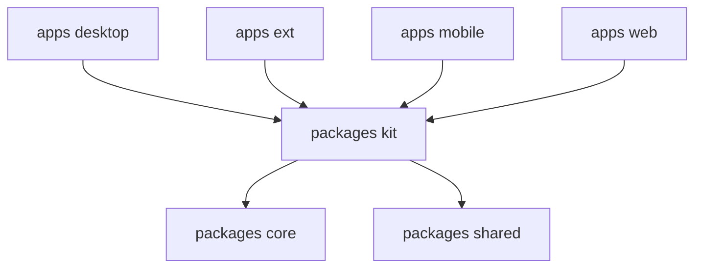

# OneKeyHQ/app-monorepo

> Open source multi-chain cryptocurrency wallet, on mobile, desktop, extension and web.

## The problem
Managing assets on several blockchains with a single wallet, including with dedicated hardware.

## What it actually does
Yarn monorepo: desktop apps (Electron), Chrome extension, mobile (React Native), web and embedded component, plus shared packages (crypto core, kit, QR wallet SDK). The README calls itself anti-scam and supports Bitcoin, Ethereum, Solana, Tron and BNB Smart Chain. Releases are signed, fingerprint published.

## How it is wired
Simplified diagram based on the fiche, no diagram provided.


## Trying it
```bash
git clone https://github.com/OneKeyHQ/app-monorepo.git
cd app-monorepo
yarn
yarn app:web
```

## Cost and gotchas
Free. Node 22 or later, Yarn 4, Git LFS; Xcode and JDK for mobile. License present but unidentified. A wallet handles money: verify the signature of downloads.

## What it is not
Not a data nor trading tool: only a wallet.

## Alternatives
No alternative named in the README.

## For you
Ignore: crypto domain unrelated to your profile, and license to clarify.
