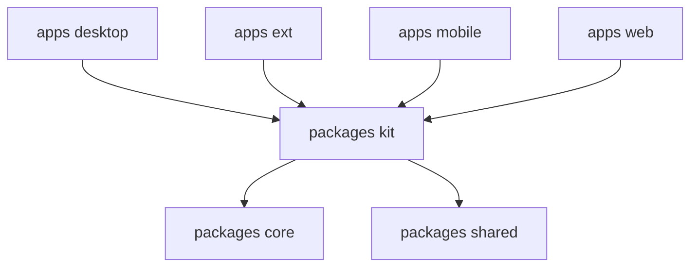

# OneKeyHQ/app-monorepo

> Portefeuille de cryptomonnaies open source multi-chaînes, sur mobile, bureau, extension et web.

## Le problème
Gérer des actifs sur plusieurs blockchains avec un seul portefeuille, y compris avec un matériel dédié.

## Ce que ça fait vraiment
Monorepo Yarn : apps bureau (Electron), extension Chrome, mobile (React Native), web et composant embarqué, plus des paquets partagés (cœur crypto, kit, SDK de portefeuille QR). Le README se dit anti-arnaque et prend en charge Bitcoin, Ethereum, Solana, Tron et BNB Smart Chain. Les releases sont signées, empreinte publiée.

## Comment c'est branché
Schéma simplifié d'après la fiche, sans diagramme fourni.


## Essayer
```bash
git clone https://github.com/OneKeyHQ/app-monorepo.git
cd app-monorepo
yarn
yarn app:web
```

## Coût et pièges
Gratuit. Node 22 ou plus, Yarn 4, Git LFS ; Xcode et JDK pour mobile. Licence présente mais non identifiée. Un portefeuille manipule de l'argent : vérifier la signature des téléchargements.

## Ce que ce n'est pas
Pas un outil de données ni de trading : uniquement un portefeuille.

## Alternatives
Aucune alternative nommée dans le README.

## Pour toi
À ignorer : domaine crypto sans rapport avec ton profil, et licence à clarifier.

