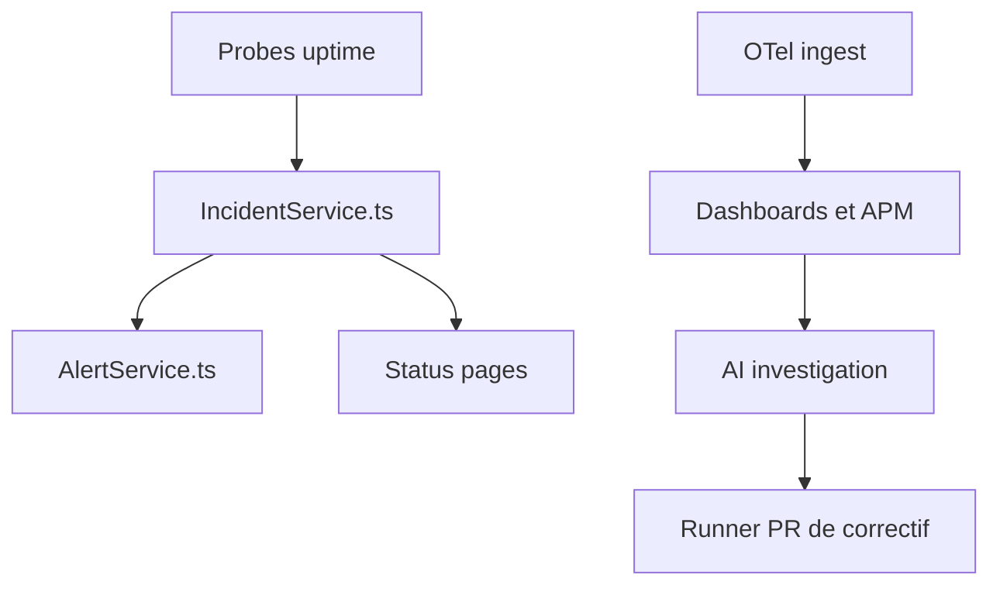

# OneUptime/oneuptime

> Self-hostable observability platform: monitoring, on-call, status pages, logs and traces.

## The problem
Monitoring, alerting, on-call and customer communication often live in separate tools.

## What it actually does
Probes test websites, APIs, ports, DNS and certificates; OpenTelemetry feeds logs, metrics and traces. Incidents trigger alerts (phone, SMS, Slack, Teams) and status pages. An AI analyzes incidents and can open a fix pull request. API, CLI, Terraform and an MCP server are provided.

## How it is wired


## Trying it
```bash
git clone --depth 1 --single-branch --branch release https://github.com/OneUptime/oneuptime.git
cd oneuptime
cp config.example.env config.env
npm start
helm repo add oneuptime https://helm-chart.oneuptime.com/
helm install my-oneuptime oneuptime/oneuptime --set host=oneuptime.example.com
```

## Cost and gotchas
Self-hosting: Linux server with 8 GB minimum, Docker, Git, Node.js. The cloud has a free plan without a card; paid plans are not detailed. The license is not identified by GitHub.

## What it is not
Not a lightweight tool: it is a complete suite. The architecture notes that several branches of the product were not verified in the code.

## Alternatives
No alternative named in the README.

## For you
Worth watching: useful for monitoring inference services, but heavy to host and the license needs clarifying.
