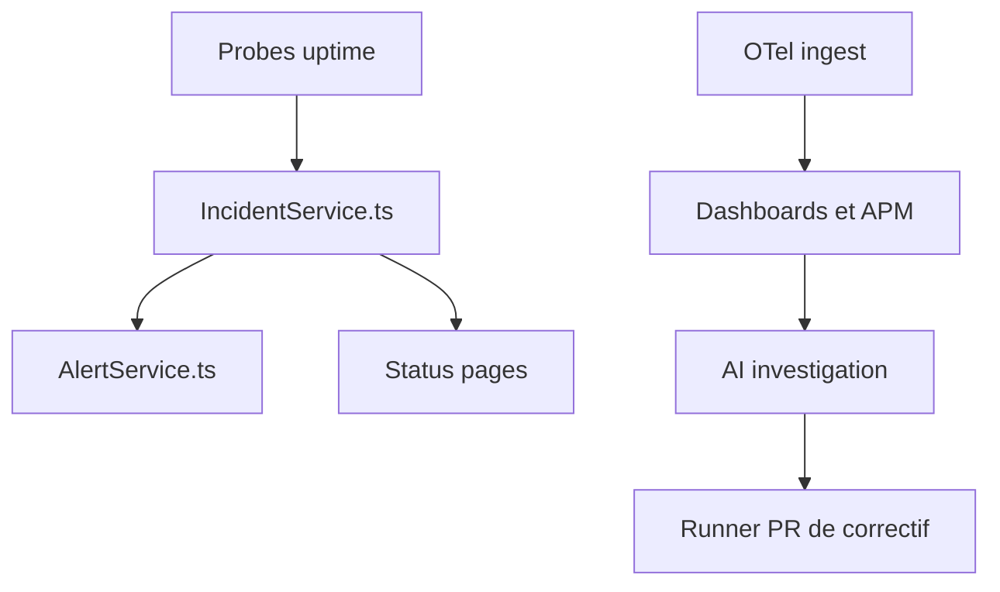

# OneUptime/oneuptime

> Plateforme d'observabilité auto-hébergeable : supervision, astreinte, pages de statut, logs et traces.

## Le problème
Surveillance, alertes, astreinte et communication clients vivent souvent dans des outils séparés.

## Ce que ça fait vraiment
Des sondes testent sites, API, ports, DNS et certificats ; OpenTelemetry alimente logs, métriques et traces. Les incidents déclenchent des alertes (téléphone, SMS, Slack, Teams) et des pages de statut. Une IA analyse les incidents et peut ouvrir une pull request de correctif. API, CLI, Terraform et serveur MCP sont fournis.

## Comment c'est branché


## Essayer
```bash
git clone --depth 1 --single-branch --branch release https://github.com/OneUptime/oneuptime.git
cd oneuptime
cp config.example.env config.env
npm start
helm repo add oneuptime https://helm-chart.oneuptime.com/
helm install my-oneuptime oneuptime/oneuptime --set host=oneuptime.example.com
```

## Coût et pièges
Auto-hébergement : serveur Linux de 8 Go minimum, Docker, Git, Node.js. Le cloud a un plan gratuit sans carte ; les offres payantes ne sont pas détaillées. La licence n'est pas identifiée par GitHub.

## Ce que ce n'est pas
Pas un outil léger : c'est une suite complète. L'architecture précise que plusieurs branches du produit n'ont pas été vérifiées dans le code.

## Alternatives
Aucune alternative nommée dans le README.

## Pour toi
À surveiller : utile pour superviser des services d'inférence, mais lourd à héberger et licence à clarifier.

