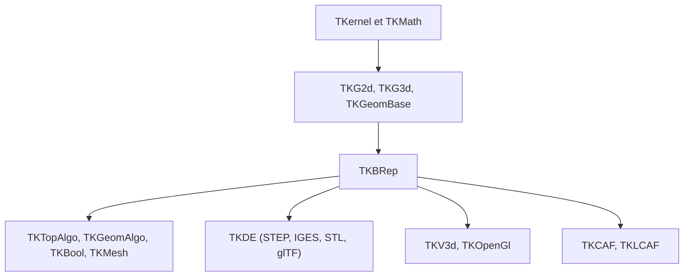

# Open-Cascade-SAS/OCCT

> C++ platform for 3D modeling, CAD data exchange and visualization, for CAD, CAM and CAE software.

## The problem
Writing a 3D modeling kernel (surfaces, solids, booleans) from scratch is a multi-year undertaking.

## What it actually does
C++ libraries for 2D and 3D geometry, boundary representations (BRep), boolean operations and meshing, plus STEP, IGES, STL and glTF data exchange. It includes OpenGL visualization and an application framework with documents and persistence. It is obtained as a Git repository, source archive or binary package.

## How it is wired

## Trying it
No command documented in the README: it points to dox/build/build_occt/building_occt.md for building (CMake) and to adm/gendoc for generating the documentation.

## Cost and gotchas
Free. You must rebuild OCCT for your platform and compiler to guarantee binary compatibility; the HTML documentation requires Doxygen. LGPL-2.1.

## What it is not
Not CAD software: a library for building it. The provided diagram summarizes the documented domains without detailing internal calls.

## Alternatives
No alternative cited in the README.

## For you
Ignore: C++ CAD kernel unrelated to data or AI, unless you have a digital twin project.
