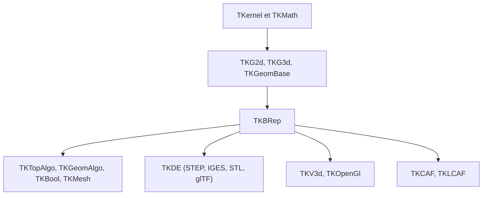

# Open-Cascade-SAS/OCCT

> Plateforme C++ de modélisation 3D, d'échange de données CAO et de visualisation, pour logiciels CAO, FAO et CAE.

## Le problème
Écrire un noyau de modélisation 3D (surfaces, solides, booléens) à partir de zéro est un chantier de plusieurs années.

## Ce que ça fait vraiment
Bibliothèques C++ pour la géométrie 2D et 3D, les représentations de bord (BRep), les opérations booléennes et le maillage, plus l'échange de données STEP, IGES, STL et glTF. Elle inclut la visualisation via OpenGL et un cadre d'application avec documents et persistance. Elle se récupère en dépôt Git, archive source ou paquet binaire.

## Comment c'est branché

## Essayer
Aucune commande documentée dans le README : renvoi vers dox/build/build_occt/building_occt.md pour compiler (CMake) et vers adm/gendoc pour générer la documentation.

## Coût et pièges
Gratuit. Il faut recompiler OCCT pour ta plateforme et ton compilateur pour garantir la compatibilité binaire ; la documentation HTML demande Doxygen. LGPL-2.1.

## Ce que ce n'est pas
Pas un logiciel de CAO : une bibliothèque pour en construire. Le schéma fourni résume les domaines documentés sans détailler les appels internes.

## Alternatives
Aucune alternative citée dans le README.

## Pour toi
Ignorer : noyau CAO en C++ sans rapport avec la data ou l'IA, sauf projet de jumeau numérique.

