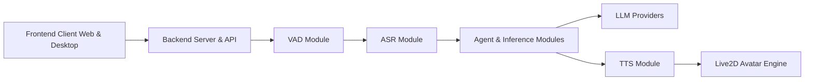

# Open-LLM-VTuber/Open-LLM-VTuber

> Voice AI companion with a Live2D avatar, able to run offline, on the web or on the desktop.

## The problem
Assembling speech recognition, an LLM, speech synthesis and a real-time animated avatar takes a lot of integration work.

## What it actually does
Voice loop: VAD → ASR (sherpa-onnx, Faster-Whisper…) → agent/LLM (Ollama, OpenAI, Claude…) → TTS (MeloTTS, CosyVoice, Edge TTS…).
Live2D avatar with expressions, a transparent "pet" mode on the desktop, camera/screen perception.
Modules are swappable through configuration via factories; persistent chat history.

## How it is wired


## Trying it
```bash
uv run update.py
```

## Cost and gotchas
Free when run locally (a GPU is recommended); remote access requires HTTPS for the microphone. v1.0.0 broke the config.

## What it is not
Functionally paused: the team is rewriting everything as v2 and refuses new requests on v1. Live2D models are under a separate license.

## Alternatives
- ylxmf2005/LLM-Live2D-Desktop-Assitant: Live2D desktop assistant with computer control, cited as a related project.

## For you
Ignore: consumer application being redesigned; only the modular ASR→LLM→TTS wiring may serve as an example.
