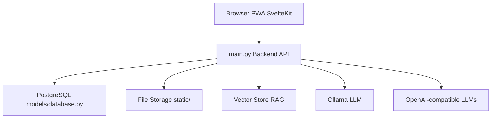

# Open-TutorAi/open-tutor-ai-CE

> Web platform for AI tutoring, with learner profiles, avatars and RAG, for teachers and students.

## The problem
General-purpose chat assistants offer no classes, no roles, and no tutoring adapted to each learner.

## What it actually does
SvelteKit web application with a FastAPI API: voice, video and avatar conversations, RAG over documents, image generation (AUTOMATIC1111, ComfyUI, DALL-E), role-based access control and evaluation of the LLM's answers. Local models via Ollama or OpenAI-compatible APIs. The first account created becomes administrator.

## How it is wired


## Trying it
```bash
cp .env.example .env
docker compose --env-file .env -f devops/docker/docker-compose.yaml up --build
docker exec -it ollama ollama pull llama3.2
```

## Cost and gotchas
Docker and at least 8 GB of RAM recommended; GPU optional (NVIDIA or AMD). An API key only if you use an external provider. Replace `SECRET_KEY` in production.

## What it is not
Not all the features of the Enterprise edition: custom theme, SLA and LTS versions are paid. The README also describes an agentic architecture that is still a target, not delivered.

## Alternatives
No alternative named in the README.

## For you
Watch: a complete local LLM stack to try in Docker, but its README is rough and the agentic layer does not exist yet.
