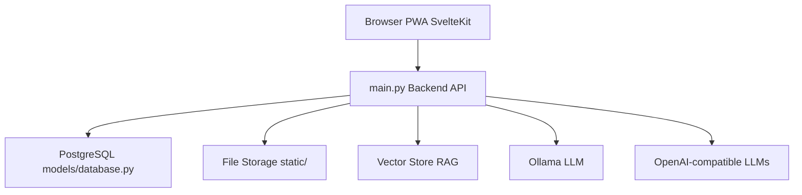

# Open-TutorAi/open-tutor-ai-CE

> Plateforme web de tutorat par IA, avec profils d'apprenants, avatars et RAG, pour enseignants et élèves.

## Le problème
Les assistants de chat généralistes n'offrent ni classes, ni rôles, ni tutorat adapté à chaque apprenant.

## Ce que ça fait vraiment
Application web SvelteKit avec API FastAPI : discussions voix, vidéo et avatar, RAG sur documents, génération d'images (AUTOMATIC1111, ComfyUI, DALL-E), contrôle d'accès par rôles et évaluation des réponses du LLM. Modèles locaux via Ollama ou API compatibles OpenAI. Le premier compte créé devient administrateur.

## Comment c'est branché


## Essayer
```bash
cp .env.example .env
docker compose --env-file .env -f devops/docker/docker-compose.yaml up --build
docker exec -it ollama ollama pull llama3.2
```

## Coût et pièges
Docker et au moins 8 Go de RAM recommandés ; GPU optionnel (NVIDIA ou AMD). Clé d'API seulement si tu utilises un fournisseur externe. Remplacer `SECRET_KEY` en production.

## Ce que ce n'est pas
Pas toutes les fonctions de l'édition Enterprise : thème personnalisé, SLA et versions LTS sont payants. Le README décrit aussi une architecture agentique encore cible, pas livrée.

## Alternatives
Aucune alternative nommée dans le README.

## Pour toi
Surveiller : pile LLM locale complète à essayer en Docker, mais son README est brouillon et la couche agentique n'existe pas encore.

