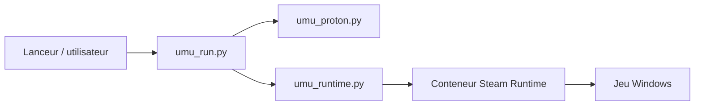

# Open-Wine-Components/umu-launcher

> Unified launcher for Windows games on Linux, which runs Proton in the Steam runtime without Steam.

## The problem
Each launcher (Lutris, Heroic, Bottles) manages its own patch scripts to run games with Proton.

## What it actually does
`umu-run` takes an executable, a Wine prefix, a Proton version, a GAMEID and a STORE, then launches the game in the Steam Linux Runtime container as Steam would. It downloads the runtime and Proton (UMU-Proton by default or GE-Proton) and aims for a common base of fixes (protonfixes). The runtime files go in `$HOME/.local/share/umu`.

## How it is wired


## Trying it
```shell
git clone --recurse-submodules https://github.com/Open-Wine-Components/umu-launcher
./configure.sh --prefix=/usr
make
make install
```

## Cost and gotchas
Free. Building requires bash, make, scdoc, Python tools and cargo. Logs with `UMU_LOG=1` and `PROTON_LOG=1`. Do not report issues with unsupported compatibility tools here.

## What it is not
Not a game library manager. The online fix base remains, according to the README, more an intention than a reality.

## Alternatives
No alternative named in the README (Lutris, Heroic, Bottles are clients of umu).

## For you
Ignore it: gaming on Linux, unrelated to data/AI.
