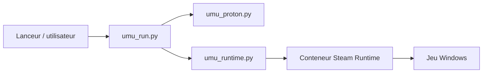

# Open-Wine-Components/umu-launcher

> Lanceur unifié de jeux Windows sous Linux, qui exécute Proton dans le runtime Steam sans Steam.

## Le problème
Chaque lanceur (Lutris, Heroic, Bottles) gère ses propres scripts de correctifs pour lancer des jeux avec Proton.

## Ce que ça fait vraiment
`umu-run` prend un exécutable, un préfixe Wine, une version de Proton, un GAMEID et un STORE, puis lance le jeu dans le conteneur Steam Linux Runtime comme le ferait Steam. Il télécharge le runtime et Proton (UMU-Proton par défaut ou GE-Proton) et vise une base commune de correctifs (protonfixes). Les fichiers du runtime vont dans `$HOME/.local/share/umu`.

## Comment c'est branché


## Essayer
```shell
git clone --recurse-submodules https://github.com/Open-Wine-Components/umu-launcher
./configure.sh --prefix=/usr
make
make install
```

## Coût et pièges
Gratuit. Compilation avec bash, make, scdoc, outils Python et cargo. Logs avec `UMU_LOG=1` et `PROTON_LOG=1`. Ne pas signaler ici les problèmes d'outils de compatibilité non pris en charge.

## Ce que ce n'est pas
Pas un gestionnaire de bibliothèque de jeux. La base de correctifs en ligne reste, d'après le README, une intention plus qu'une réalité.

## Alternatives
Aucune alternative nommée dans le README (Lutris, Heroic, Bottles sont des clients de umu).

## Pour toi
À ignorer : jeu sous Linux, sans lien avec data/IA.

