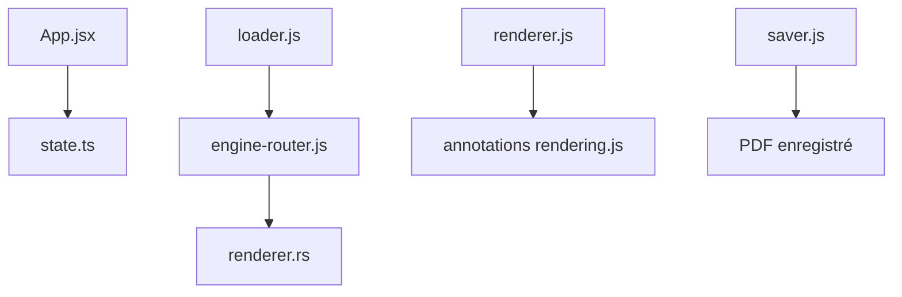

# OpenAEC-Foundation/open-pdf-studio

> Free PDF editor for construction drawings: annotation, scaled measurement, revision comparison, CAD import.

## The problem
PDF editors specialized in drawings are paid, with a subscription or a watermark.

## What it actually does
Annotations (clouds, dimensions, stamps), measurements at the drawing's scale, quantities exportable to CSV, redaction, comparison of two revisions. The desktop version adds OCR, DWG/DXF import and export, signatures and printing to scale. Runs on Windows, macOS, Linux, Android and in the browser. A local MCP server exposes 94 tools to an assistant.

## How it is wired


## Trying it
```bash
git clone https://github.com/OpenAEC-Foundation/open-pdf-studio.git
cd open-pdf-studio/open-pdf-studio
npm ci
npm run tauri:dev
```

## Cost and gotchas
Free, no account or telemetry. Build: Node 22, Rust, CMake. Listed limitations: crashes when zooming on some Linux systems, Android update cannot be installed over the existing app. If the MCP assistant is online, the text of documents is sent to it.

## What it is not
Not a document extraction or analysis tool for AI. The browser version has no OCR, no CAD and no MCP.

## Alternatives
No alternative named in the README.

## For you
Watch: the 94-tool MCP server is a curiosity for driving PDFs from an agent, but the core of the product targets architecture and construction.
