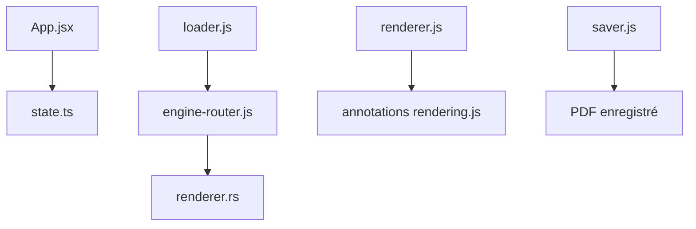

# OpenAEC-Foundation/open-pdf-studio

> Éditeur PDF libre pour plans : annotation, mesure à l'échelle, comparaison de révisions, import CAO.

## Le problème
Les éditeurs PDF spécialisés dans les plans sont payants, avec abonnement ou filigrane.

## Ce que ça fait vraiment
Annotations (nuages, cotations, tampons), mesures à l'échelle du plan, quantités exportables en CSV, caviardage, comparaison de deux révisions. Le bureau ajoute OCR, import et export DWG/DXF, signatures et impression à l'échelle. Fonctionne sur Windows, macOS, Linux, Android et navigateur. Un serveur MCP local expose 94 outils à un assistant.

## Comment c'est branché


## Essayer
```bash
git clone https://github.com/OpenAEC-Foundation/open-pdf-studio.git
cd open-pdf-studio/open-pdf-studio
npm ci
npm run tauri:dev
```

## Coût et pièges
Gratuit, sans compte ni télémétrie. Compilation : Node 22, Rust, CMake. Limites listées : plantages au zoom sur certains Linux, mise à jour Android non installable par-dessus. Si l'assistant MCP est en ligne, le texte des documents lui est envoyé.

## Ce que ce n'est pas
Pas un outil d'extraction ou d'analyse documentaire pour l'IA. La version navigateur n'a ni OCR, ni CAO, ni MCP.

## Alternatives
Aucune alternative nommée dans le README.

## Pour toi
Surveiller : le serveur MCP à 94 outils est une curiosité pour piloter des PDF depuis un agent, mais le cœur du produit vise l'architecture et le bâtiment.

