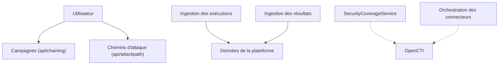

# OpenAEV-Platform/openaev

> Filigran's platform for planning and running adversary simulations and crisis exercises.

## The problem
Measuring whether an organization withstands real threats requires coordinated exercises, which are hard to track in spreadsheets.

## What it actually does
Plans scenarios and simulations, sends "injects" (email, SMS, social networks) through integrations, and displays attack paths, results and coverage gaps. Exchanges security coverage with OpenCTI. Two editions: Community (Apache 2.0) and Enterprise (its own license).

## How it is wired


## Trying it
```bash
# Aucune commande documentée dans le README : installation par Docker ou manuelle, voir la documentation officielle.
```

## Cost and gotchas
The Community edition is free; Enterprise is paid and can be enabled in the settings. The platform collects anonymous usage telemetry. A license is present but not identified by GitHub.

## What it is not
Not a scanner or an autonomous intrusion tool: it is an orchestrator of exercises and simulations. The README says it is under heavy development.

## Alternatives
OpenCTI, cited in the README as a source of threat knowledge, complementary rather than competing.

## For you
Worth watching: relevant if you work on security or threats, but the license, telemetry and Enterprise edition call for a careful read before any use.
