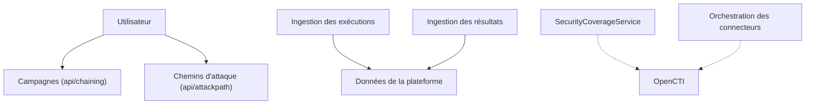

# OpenAEV-Platform/openaev

> Plateforme de Filigran pour planifier et jouer des simulations d'adversaires et des exercices de crise.

## Le problème
Mesurer si une organisation résiste à des menaces réelles demande des exercices coordonnés, difficiles à suivre dans des tableurs.

## Ce que ça fait vraiment
Planifie des scénarios et des simulations, envoie des « injects » (e-mail, SMS, réseaux sociaux) via des intégrations, et affiche chemins d'attaque, résultats et lacunes de couverture. Échange de la couverture de sécurité avec OpenCTI. Deux éditions : Community (Apache 2.0) et Enterprise (licence propre).

## Comment c'est branché


## Essayer
```bash
# Aucune commande documentée dans le README : installation par Docker ou manuelle, voir la documentation officielle.
```

## Coût et pièges
Édition Community gratuite ; l'Enterprise est payante et activable dans les réglages. La plateforme collecte une télémétrie d'usage anonyme. Licence présente mais non identifiée par GitHub.

## Ce que ce n'est pas
Pas un scanner ni un outil d'intrusion autonome : c'est un orchestrateur d'exercices et de simulations. Le README dit qu'elle est en fort développement.

## Alternatives
OpenCTI, cité dans le README comme source de connaissance sur les menaces, complémentaire plutôt que concurrent.

## Pour toi
À surveiller : pertinent si tu touches à la sécurité ou à la menace, mais licence, télémétrie et édition Enterprise demandent une lecture avant tout usage.

