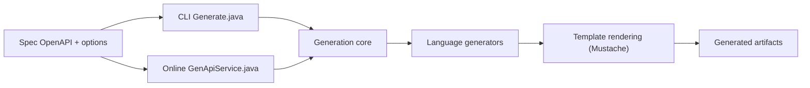

# OpenAPITools/openapi-generator

> Generates SDK clients, server stubs and documentation from an OpenAPI spec, for multi-language API teams.

## The problem
Writing by hand the clients and server skeletons of each API, in each language, then keeping them aligned with the spec.

## What it actually does
From an OpenAPI spec (2.0, 3.0, 3.1 in beta), produces clients, server stubs, docs (HTML, Markdown, AsciiDoc…) and other artifacts (Postman, GraphQL, protobuf…). Generators rely on customizable Mustache templates (`-t`). It exists as a CLI (Java 11+ JAR), Maven/Gradle/Mill plugin, Docker image, npm or pip package, and web service.

## How it is wired


## Trying it
```bash
docker run --rm -v "${PWD}:/local" openapitools/openapi-generator-cli generate \
    -i https://raw.githubusercontent.com/openapitools/openapi-generator/master/modules/openapi-generator/src/test/resources/3_0/petstore.yaml \
    -g go \
    -o /local/out/go
```

## Cost and gotchas
Free; requires a Java 11 runtime (or Docker). The README warns: an untrusted spec or template can cause code injection in the generated code.

## What it is not
Not affiliated with the OpenAPI Initiative. Generated code quality varies by generator; 5,793 open issues. "Experimental" generators are not all at the same level.

## Alternatives
- Swagger Codegen: the ancestor this project is a fork of (migration guide provided).

## For you
Adopt as soon as you need to expose or consume a REST API in several languages (a Python client for an ML service, for example): maintained, Apache-2.0 license, huge user base.
